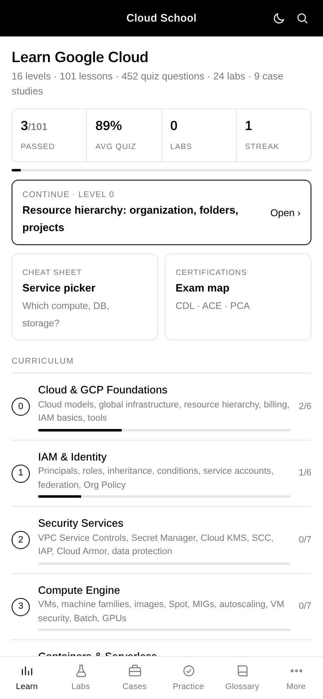
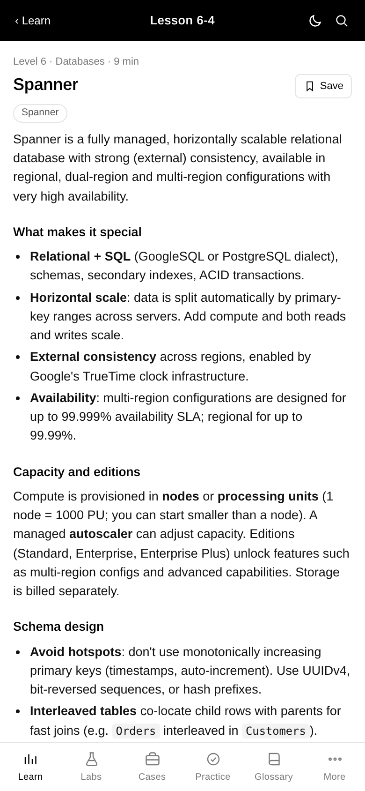
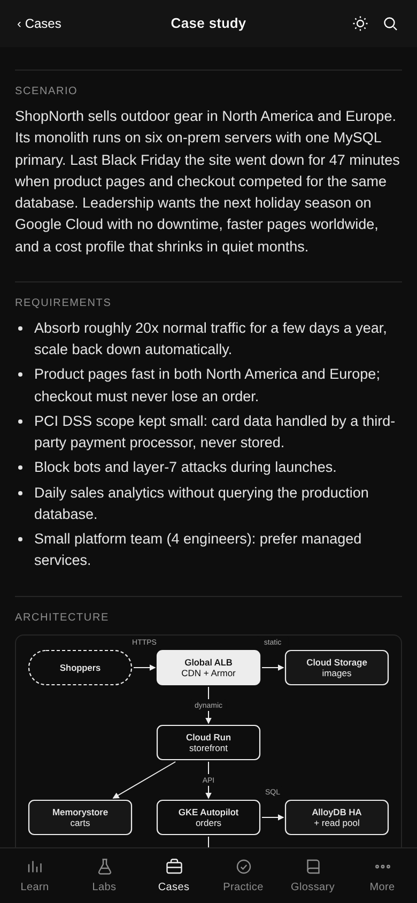
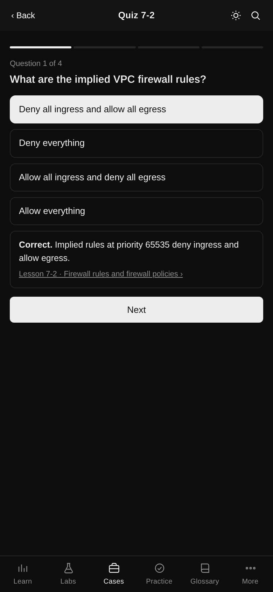
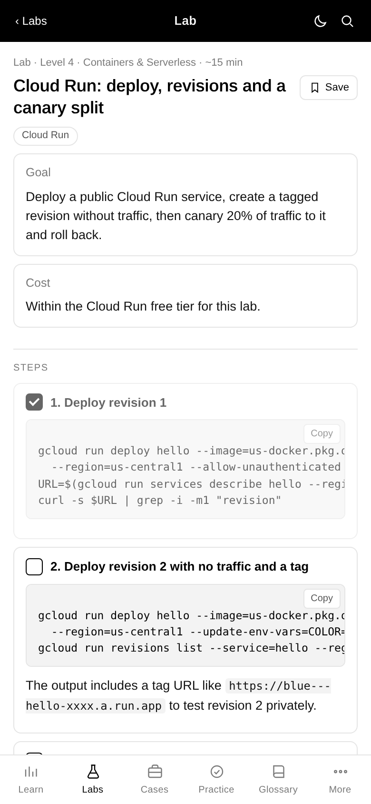
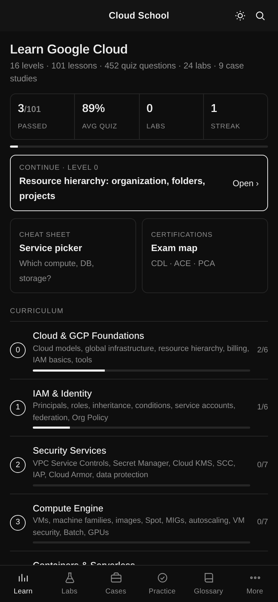
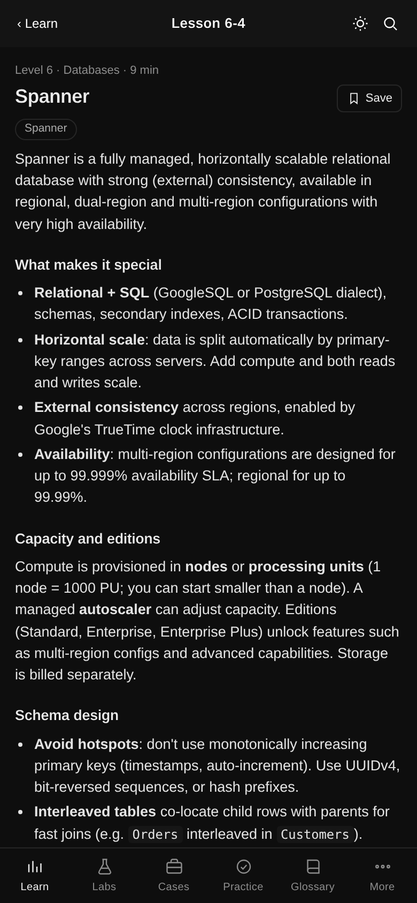
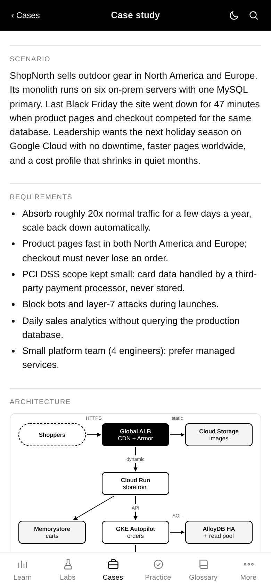

# Cloud School

Learn Google Cloud (GCP) from your first project to architect-level design: lessons, quizzes, hands-on labs and corporate case studies, in a small offline app.

**Open it:** [kavdope.github.io/cloud-school](https://kavdope.github.io/cloud-school/)

  
  
  
  

## What it is

Cloud School is a free Google Cloud course that runs in your browser and works offline. It starts with what a region, a project and a billing account are, and works up to multi-region architectures, data platforms, AI, security perimeters and cost management. Every lesson explains the service, when to use it instead of the alternatives, a worked example, real `gcloud`/`bq`/`kubectl`/Terraform commands and the gotchas that trip people up, followed by a quiz.

## Features

- **16 levels, beginner to advanced.** 101 lessons and 452 multiple-choice questions, each with an explanation. 80% passes a lesson quiz. Lessons are never locked.
- **24 hands-on labs.** Goal, cost note, numbered steps with copyable commands, a verify step and a cleanup step so you don't leave anything billing. Step checkboxes save your place.
- **9 corporate case studies.** Retail, fintech, streaming media, healthcare, gaming, data-center migration, multi-tenant SaaS, generative AI and industrial IoT. Each has requirements, an architecture diagram, the services chosen and why, a tradeoff table, the exam angle and a quiz. All companies are fictional.
- **Practice exams.** Cloud Digital Leader, Associate Cloud Engineer and Professional Cloud Architect style sets, mixed sets, per-level sets and a "missed questions" set.
- **Service picker.** Decision trees and comparison tables for compute, databases, storage, data processing, messaging, load balancers, hybrid connectivity and authentication.
- **Certification map.** What each certification covers and which levels to study.
- **262-term glossary, search and bookmarks.** Search across lessons, labs, cases and the glossary, and save anything.
- **Dark and light mode.** Follows your device by default; switch from the top bar or in Settings.
- **Offline PWA.** Works without a connection after the first visit. On iPhone, open the site in Safari and tap **Share > Add to Home Screen**.

  
  
  
  

## Curriculum

| Level | Title | Covers | Lessons |
|---:|---|---|---:|
| 0 | Cloud & GCP Foundations | Cloud models, global infrastructure, resource hierarchy, billing, IAM basics, tools | 6 |
| 1 | IAM & Identity | Principals, roles, inheritance, conditions, service accounts, federation, Org Policy | 6 |
| 2 | Security Services | VPC Service Controls, Secret Manager, Cloud KMS, SCC, IAP, Cloud Armor, data protection | 7 |
| 3 | Compute Engine | VMs, machine families, images, Spot, MIGs, autoscaling, VM security, Batch, GPUs | 7 |
| 4 | Containers & Serverless | GKE, Autopilot, Cloud Run, Cloud Run functions, App Engine, eventing and orchestration | 7 |
| 5 | Storage | Cloud Storage, classes, lifecycle, data protection, Persistent Disk, Hyperdisk, Filestore, transfers | 5 |
| 6 | Databases | Choosing a database, Cloud SQL, AlloyDB, Spanner, Bigtable, Firestore, Memorystore | 7 |
| 7 | Networking I: VPC | Subnets, firewalls, routes, Private Google Access, Cloud NAT, Shared VPC, peering, PSC | 6 |
| 8 | Networking II: Edge & Hybrid | Load balancing, Cloud CDN, Cloud DNS, Cloud VPN, Interconnect, network tiers, troubleshooting | 6 |
| 9 | Data & Analytics | BigQuery, Pub/Sub, Dataflow, Dataproc, Composer, Dataform, Datastream, Looker, Dataplex | 10 |
| 10 | AI & ML | Gemini on Vertex AI, training and AutoML, MLOps, Model Garden and tuning, RAG and agents | 6 |
| 11 | DevOps & IaC | Cloud Build, Artifact Registry, Cloud Deploy, supply chain security, Terraform, Infrastructure Manager | 6 |
| 12 | Operations & Observability | Monitoring, Logging, Audit Logs, alerting and SLOs, Trace, Profiler, Error Reporting | 6 |
| 13 | Cost Management (FinOps) | Billing model, billing export, budgets, discounts, labels and tags, optimization | 5 |
| 14 | Architecture | Well-Architected Framework, HA, DR, landing zones, migration, hybrid and modern app patterns | 7 |
| 15 | Certification Prep | Cloud Digital Leader, Associate Cloud Engineer, Professional Cloud Architect, exam technique | 4 |

Labs cover project setup with a budget, IAM custom roles and conditions, keyless service accounts, Secret Manager, CMEK, VMs with IAP SSH, managed instance groups, GKE Autopilot, Cloud Run canaries, event-driven functions, static sites on Cloud Storage, Cloud SQL, Firestore, private VPCs with Cloud NAT, a global load balancer with Cloud Armor, BigQuery cost control, Pub/Sub to BigQuery, BigQuery ML, Gemini on Vertex AI, Cloud Build CI, Terraform, monitoring and alerting, a cost hunt and a cross-region DR drill.

## Accuracy

Content reflects Google Cloud as of late 2026. Pricing is described qualitatively (what drives cost, what's free tier eligible) rather than with numbers, because prices change; check the official pricing pages and calculator before you build. Model names change quickly, so the AI lessons tell you to check Model Garden for current model IDs. If you spot something outdated, open an issue.

## Privacy

There are no accounts, ads, analytics or trackers, and no external scripts, fonts or CDNs. Progress, quiz scores, bookmarks and your theme choice are stored only in your browser (localStorage). Nothing is sent anywhere. Clearing site data, or Reset in Settings, removes it.

## Tech

Plain HTML, CSS and JavaScript with no frameworks or dependencies. Diagrams are SVG generated in the browser. A service worker caches the app for offline use, and a strict Content Security Policy only allows the app's own files.

## Disclaimer

Cloud School is an unofficial study aid. It is not affiliated with, endorsed by or sponsored by Google LLC. Google Cloud, GCP and related product names are trademarks of Google LLC. Certification names belong to Google; exam content here is practice material, not real exam questions. Labs run in your own Google Cloud account and can incur charges: use a budget alert and always run the cleanup steps.
